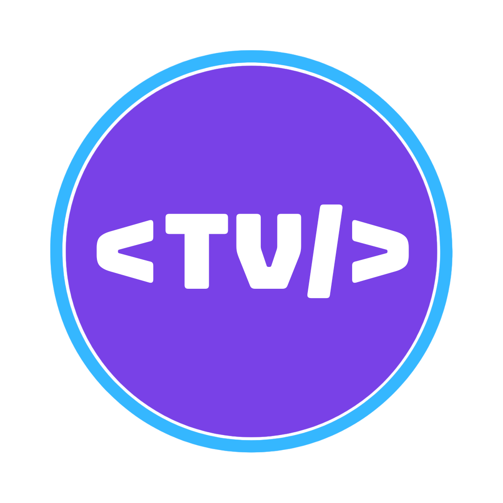

## Hi, I'm Rodrigo Vianna (Rods) 👋

👨‍💻 I'm a Software Engineer exploring the mobile world. I enjoy working remotely.

🎮 I enjoy sports, video games and D&D 🎲

🌎 I build personal and open source projects to help the community.

---

### CodandoTV

I created **CodandoTV**, a channel and initiative for the developer community, to share knowledge and experiences about technology and careers. Through videos, podcasts, mentoring and open source projects, we learn and build together.

  
  

  

---

### Outside the tech world

